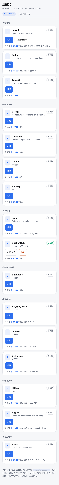

# dsh-connectors

> 一次连接，处处可用。给 DeepSeek Harness 一个统一的凭据保险库：GitHub、GitLab、Gitee、Vercel、Cloudflare、npm 等平台的令牌只存一次，会话、工具、其他插件都能直接复用。



## 它解决什么问题

在 DSH 里让 Agent 推代码、发版、查 CI，通常要经历同一套重复劳动：去平台建一个 Token，粘到环境变量或对话里，换个会话或换台设备再粘一次；装了第二个插件，又要配一遍。

这个插件把这件事收敛成三步：**连一次 → 加密存在本机 → 所有调用方复用**。

- **不用每次发令牌**：凭据落在 harness 的状态目录，重启、换会话、换 profile 都还在。
- **令牌不进对话记录**：DSH 的轨迹会记录一切，所以令牌只能从设置页、独立页面或终端输入，永远不经过聊天框。
- **只在对的平台使用**：模型只能指定"平台 + 路径"，域名由插件固定；拿 GitHub 的令牌打不到别的地方去。
- **别的插件能接手**：插件注册了 `connectors` 服务，下一个插件不用再问你要 Token。

## 支持的平台

| 类别 | 平台 | 认证方式 |
| --- | --- | --- |
| 代码托管 | GitHub（支持设备码登录）、GitLab、Gitee | Bearer / PRIVATE-TOKEN / token |
| 部署与托管 | Vercel、Cloudflare、Netlify、Railway | Bearer |
| 包与镜像 | npm、Docker Hub | Bearer / Basic |
| 数据库与后端 | Supabase | Bearer |
| 模型与 AI | Hugging Face、OpenAI、Anthropic | Bearer / x-api-key |
| 设计与文档 | Figma、Notion | X-Figma-Token / Bearer |
| 协作与通知 | Slack | Bearer |

没有内置的平台可以自己加，见[自定义平台](#自定义平台)。

## 安装

```bash
# 从 GitHub 安装（推荐，DSH 内置解析）
dsh plugin --profile web add github:giangnam728828-rgb/dsh-connectors

# 本地目录开发
dsh plugin --profile web add /绝对路径/dsh-connectors

# 从 npm 安装（npm 发布之后可用）
dsh plugin --profile web add dsh-connectors
```

安装后重启 `dsh web`，打开 **设置 → 连接器**。

> 兼容基线：DSH 0.2.1-rc.3 到 0.2.x，Node `^22.19 || >=24`（DSH 自身用到了 `import.meta.main` 和 `zlib` 的 zstd 导出，更老的 Node 会在启动阶段静默退出）。逐项实测见下表。

### 载体兼容矩阵

DSH 官方发行版只有五种 profile 模板，**没有 `desktop` 这一档**——所谓"桌面端"就是 `web` profile 跑在浏览器里。插件按服务存在与否分面挂载，每种载体拿到的功能如下（全部在本仓库 0.2.1 上实测）：

| 载体 | profile | 工具 `conn_list` / `conn_request` | `connectors` 服务 | `/api/connectors/*` | `/dsh-connectors` 页面 | 设置页 |
| --- | --- | --- | --- | --- | --- | --- |
| 浏览器 / 桌面浏览器 | `web` | ✅ | ✅ | ✅ | ✅ | ✅ |
| 编辑器 ACP 客户端 | `acp` | ✅ | ✅ | — | — | — |
| 一次性脚本 | `headless` | ✅ | ✅ | — | — | — |
| SDK 嵌入 | `sdk` | 未测 | 未测 | — | — | — |
| 极简 SDK | `sdk-minimal` | 不适用（无 `tools`） | 不适用 | — | — | — |

"`—`"表示该载体本身没有 `connection` 或 `webServer` 服务，不是插件缺失。插件的 `inject` 只硬依赖 `tools`（DSH 的 agent 核心服务，`dsh-base` 必带）；`connection` 和 `webServer` 都是按需挂载，所以在没有 HTTP 层的 shell 里，工具和服务照常可用，页面与接口则不存在。

## 连接一个平台

三种入口，按你手边有什么选：

1. **设置页**：`设置 → 连接器`，点"连接"，粘贴令牌。适合电脑端。
2. **独立页面**：浏览器打开 `http://<你的 DSH 地址>/dsh-connectors`。布局按窄屏做的，适合手机浏览器和隧道访问；它和主界面共用同一个登录态，**未登录会返回 401**，需要先打开 DSH 主界面完成登录。
3. **终端**：手机或服务器上没有顺手的浏览器时用这个。

```bash
# 交互式，输入不回显
npx -y dsh-connectors add github

# 从管道读，不进 shell 历史
echo "$TOKEN" | npx -y dsh-connectors add vercel

# 需要用户名的平台
npx -y dsh-connectors add docker --username 你的DockerID

# 查看 / 删除
npx -y dsh-connectors list
npx -y dsh-connectors remove github
```

保存前会调用平台的身份接口校验一次。令牌写错会当场报错，而不是三轮对话之后突然 401。校验通不了网络时不会强行保存。

### GitHub 设备码登录（可选，免粘贴）

设备码流程不需要回调地址，对手机最友好：页面给你一个八位码，你在任意浏览器里批准，主机自己轮询拿令牌。

它需要一个 GitHub OAuth App 的 **Client ID**（公开信息，不需要 Client Secret）：

1. 打开 <https://github.com/settings/developers> → New OAuth App
2. 勾选 **Enable Device Flow**，回调地址随便填（流程不用它）
3. 把 Client ID 填到独立页面的"设备码登录"里，或设置环境变量：

```bash
export DSH_CONNECTORS_GITHUB_CLIENT_ID=Iv1.xxxxxxxxxxxx
```

## 在对话里怎么用

插件给了 Agent 两个工具，`README` 里写清楚是为了让你能预判它会做什么：

| 工具 | 作用 |
| --- | --- |
| `conn_list` | 列出平台与连接状态。Agent 在向你要令牌之前应该先调它。 |
| `conn_request` | 以已连接账号的身份调用该平台 API。只能传路径，域名由插件补。 |

```text
你：帮我在 GitHub 上建一个私有仓库，把这几个文件推上去
Agent：→ conn_list                 （发现 github 已连接）
       → conn_request POST /user/repos
       → conn_request GET /repos/me/demo/git/ref/heads/main
       → conn_request POST /repos/me/demo/git/blobs …
```

```json
{
  "provider": "github",
  "method": "POST",
  "path": "/repos/octocat/demo/issues",
  "body": { "title": "Build failed on main" }
}
```

返回体里的令牌会被替换成 `[redacted]`；超过 200 KB 的响应只回预览，避免把上下文撑爆。

## 给其他插件复用

这是"连接一次"最关键的一层。其他插件不需要再问用户要一遍令牌：

```js
export const inject = ['connectors'];

export function apply(ctx) {
  ctx.effect(() => {
    const connectors = ctx.get('connectors');
    if (connectors === undefined) return () => {};
    // 推荐：让 broker 代发请求，域名与请求头都被约束，令牌不出主机
    const result = await connectors.request({ provider: 'github', path: '/user' });
    return () => {};
  });
}
```

服务分三档权限：

| 能力 | 方法 | 默认 |
| --- | --- | --- |
| 连接状态 | `list()`、`status(id)`、`capabilities()` | 可用，无秘密 |
| 受限请求 | `request({ provider, method, path, query, body })` | 可用，令牌不返回 |
| 原始凭据 | `credential(id)`、`token(id)` | **默认拒绝**，抛 `raw-credentials-not-granted` |

需要原始令牌的插件（例如要自己实现 git 协议）必须由用户显式授权：

```bash
npx -y dsh-connectors allow-raw on    # 开启
npx -y dsh-connectors service         # 查看当前状态
npx -y dsh-connectors allow-raw off   # 用完关掉
```

调用方可以先问 `capabilities()` 再决定走哪条路，不会因为未授权而崩溃。约定只有一条：**令牌值不许进 prompt、不许进工具返回值**。

## git push 不再贴令牌

插件自带一个 git 凭据助手，HTTPS 推送时由它从保险库取令牌：

```bash
# 插件已装在 profile 里时，用 profile 的 bin（最稳，不联网）
git config --global credential.https://github.com.helper \
  '!/绝对路径/profiles/web/node_modules/.bin/dsh-connectors git-credential'

# 或者用 npm 上的包
git config --global credential.https://github.com.helper \
  '!npx --yes dsh-connectors git-credential'

# 验证
git push   # 不再询问用户名密码
```

`git-credential` 只在标准输出写 `username=` / `password=` 两行，日志一律走 stderr，不会破坏 git 的凭据协议。

支持 `github.com`、`gitlab.com`、`gitee.com`。SSH 方式不需要这个。

## 安全模型

说清楚边界，比堆形容词有用：

- **加密落盘**：每条凭据用 AES-256-GCM 单独加密，AAD 绑定平台 id，密文挪到别的平台名下也解不开。主密钥是独立文件，与保险库分开存放。
- **并发写**：同一目录的写入按目录排队，并用 `vault.lock` 跨进程互斥；两个进程同时保存不会互相覆盖。
- **权限**：目录 `0700`，密钥与保险库 `0600`，写入走临时文件 + rename，崩溃不会留下半截文件。
- **位置**：`$DSH_HOME/state/connectors`（或 `$DSH_CONNECTORS_HOME`），不在工作区里，Agent 的沙箱读不到。
- **出站约束**：域名来自平台预设，路径必须以 `/` 开头，`//host` 和绝对 URL 一律拒绝；`authorization`、`cookie`、`x-api-key` 等敏感头不允许调用方覆盖。
- **入口鉴权**：管理接口挂在 DSH 的 `/api/connectors/*` 上，复用宿主自己的身份校验——Host/Origin 围栏、`SameSite=Strict` 的签名会话 cookie、owner 主体检查。未登录请求返回 401，跨站请求返回 403。插件**不再自己比对 Origin**，所以经反向代理或隧道访问时不会误判；代理域名需要在 DSH 侧用 `--trusted-host` 声明，这是部署者的授权动作，插件不能绕过。
- **请求面**：只接受 POST，请求体流式读取并在 8 KB 处截断，页面带 CSP；令牌永远不会回传给浏览器。
- **插件间**：原始令牌默认不开放给其他插件，`request()` 只放行平台预设里的域名。
- **加密的边界**：密钥与密文在同一台机器、同一个系统账户下。它能挡住备份同步、误 `cat`、别的用户，**挡不住以你的账户运行的恶意程序**。
- **失败处理**：401/403 只在结果里提示"凭据失效，请重新连接"，不会自动删除一条可能只是权限不足的令牌。
- **断开**：只删除本机凭据，不撤销平台授权。要彻底撤销请去平台设置页。

## 自定义平台

不想等插件更新，就在凭据目录放一个 `providers.json`：

```json
[
  {
    "id": "acme",
    "name": "Acme Cloud",
    "category": "部署与托管",
    "baseUrl": "https://api.acme.example",
    "auth": { "kind": "bearer" },
    "verify": { "path": "/v1/me" },
    "docs": "https://acme.example/tokens",
    "gitHosts": ["git.acme.example"]
  }
]
```

`auth.kind` 支持 `bearer`、`header`（配 `header` / `prefix`）、`basic`（配 `username`）。`baseUrl` 必须是 HTTPS、不能带账号密码或查询串。`verify` 省略则跳过校验。

**内置平台 id 是保留字。** 自定义项不能用 `github`、`gitlab` 这些名字，大小写、全角、零宽空格等变体都不行；想接 GitHub Enterprise 之类，请用一个新 id（例如 `github-enterprise`）。被拒的条目不会静默生效，`status` 接口的 `rejectedProviders` 会给出原因码：`id-reserved`、`id-duplicate`、`base-url-insecure` 等。

## 移动端说明

- **DSH Go / 手机本机跑**：DSH Go 是 Flutter 原生界面，**不会渲染本插件的网页设置页**；目前可用的是独立页面（在 App 的网页版里打开）和终端命令，设备码登录比粘贴更适合手机。原生面板与斜杠命令在后续版本提供。
- **手机连电脑**：走 DSH Mobile / ds-harness-remote 时，经隧道的域名要在 DSH 侧用 `--trusted-host` 声明，否则宿主的 Host 围栏会返回 403；凭据始终保存在电脑那台机器上。
- **两边都要用**：两个 harness 各自保存一份。想共用一个目录，把 `DSH_CONNECTORS_HOME` 指到同步盘（注意同步盘的权限与备份策略）。

## 已知限制

- GitHub 设备码登录需要你自备 OAuth App Client ID；插件不内置别人的应用凭据。
- 目前只支持长期令牌，不做 OAuth 刷新令牌轮换。
- `conn_request` 是通用 REST 通道，不封装各平台的特殊协议（GraphQL 平台按原样 POST 即可）。
- DSH 还在开发者预览期，升级大版本前请先看 `engines.dsh` 是否仍然匹配。

## 开发

```bash
npm test        # 22 个单元测试：保险库、加密边界、URL 约束、脱敏、接口
npm run check   # 语法检查
```

目录：

```
index.js          主机侧：接口、工具、connectors 服务
src/providers.js  平台预设与出站约束
src/vault.js      AES-256-GCM 保险库
src/actions.js    连接、校验、代发请求、设备码
src/page.js       独立页面（内联 CSS/JS，无外部依赖）
client.js         设置页分区
bin/              命令行与 git 凭据助手
```

## 发布到插件市场

1. 仓库加 topic `dsh-plugin`
2. `package.json` 已声明 `dsh.bundle`，`files` 里包含 `cordis.patch.yml`
3. README 里保留安装命令、权限说明、兼容版本
4. 建议在 README 顶部写清"令牌如何存储、会发往哪些域名"

## License

MIT
